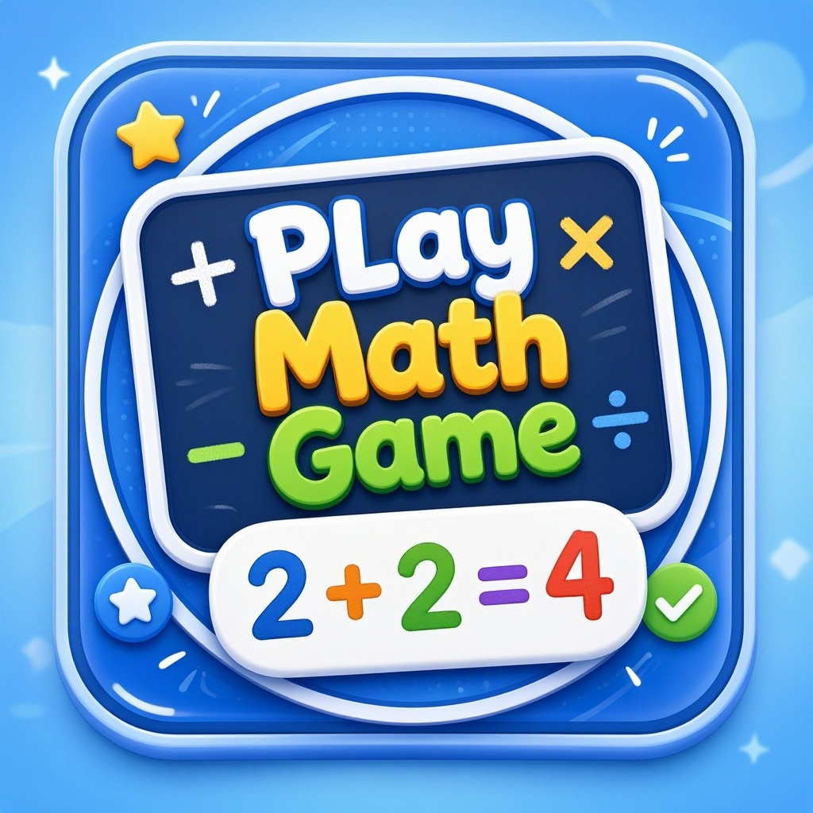



  

# 🎮 PlayMathGame — 3 игры в одном приложении для всей семьи!

📲 **[СКАЧАТЬ PlayMathGame.apk (Android)](https://github.com)**

Надоело, что телефон используется только для бесконечных видео? Превратите экран в тренажер для ума — от первых букв до хардкорной математики на скорость!

## 🔥 Что внутри:

### 1️⃣ Азбука, Фигуры и Пирамидка (для малышей 2–5 лет)
Никакого скучного текста — ребенок учится играть интуитивно!
* Собираем слова по ярким картинкам и контурам.
* Решаем наглядные примеры с фруктами и зверятами.
* Сортируем фигуры по формам и толстым цветным контурам.
* Собираем волшебную пирамидку с подсказкой «Тепло — Холодно» (солнышко греет, тучка поливает дождиком) и копим коллекцию игрушек-стикеров на экране!

### 2️⃣ Весёлые Шарики (спокойная математика)
Соединяй летающие шары, складывай и вычитай числа в своём темпе. Никаких таймеров и стресса — только приятная физика, салюты и бесконечные уровни.

### 3️⃣ Хардкор Бильярд (проверка мозга для родителей)
Думаешь, школьная математика — это легко? Попробуй собрать целевое число за считанные секунды, пока шары сами взрываются и делятся, а жизни тают на глазах!

---
✅ **Работает без интернета, идеально подстраивается под любой телефон и планшет.**

